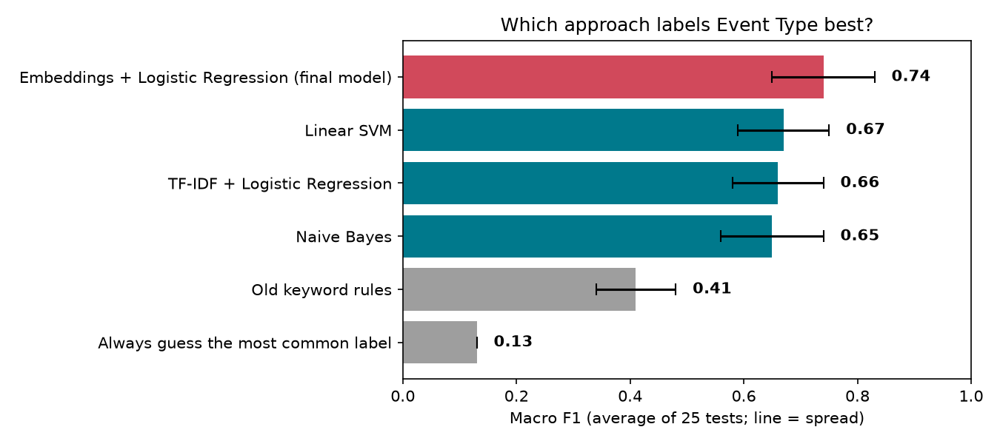

# CJP Protest Tracker: from news to data

**Live dashboard:** *(paste your Streamlit link here after deploying)*

**Research question:** *Where, why and how did students protest exam paper leaks in India, and how did authorities respond?*

The project is in two parts:
1. **Internship stage:** I built a pipeline that collects news about exam paper leaks from 3 sources (Google News RSS, GNews, NewsData.io) for 27 keywords and stores it in a Google Sheet.
2. **This version (v2):** I measured how good that data was, fixed the extraction rules, trained ML models to sort each article into an **Event Type** (the best one reads the *meaning* of each headline using sentence embeddings), and built a dashboard to explore the results.

## 1. Pipeline

```
News sources ──► Original notebook ──► 2,072 articles (spreadsheet)
                                          │
                                          ▼
                  v2: clean ─► fixed rules ─► remove duplicate stories      → 1,986 clean articles
                                          │
                  150 hand-labelled ─► sentence embeddings + Logistic Reg.   → Event Type for every article
                                          │
                                          ▼
                       charts + findings  ·  Streamlit dashboard
```

## 2. Fixing data quality (before vs after, same 2,072 articles)

|  | Original output | New rules |
| --- | --- | --- |
| Exam = Unknown | 54% | 56%\* |
| State = Unknown | 71% | **66%** |
| Wrong CAT / NDA / MAT labels | **297** | **2** (both real mentions) |
| Rows with HTML junk (`&nbsp;`) | 1,772 | 0 |
| Exam Year guessed from publish date | 1,733 | 0 |
| Duplicate stories removed | 0 | 78 |
| Rows where an organisation is identified | not tracked | 38% |

\* "Unknown exam" went up slightly *because the wrong labels were removed*. The old 54% looked better only because about 295 articles had a fake exam attached.

**The main bug:** `"CAT" in text` is also true for "edu**cat**ion". The fix is whole-word regex (`\b`), with longest names checked first ("NEET PG" before "NEET"). Ambiguous short names such as NDA (also the political alliance) only count when followed by *exam / paper / result / a year*. A city-to-state list (Patna → Bihar, Jantar Mantar → Delhi) finds more states. The notebook has `assert` checks for each bug.

## 3. Event Type: old rules vs ML models

There are 4 labels: **Protest**, **Leak & Investigation**, **Court & Govt response**, **Not relevant**.

- 150 random articles were labelled as the answer key. Claude suggested a label for each, and I checked every one.
- Each model was trained on 120 of them and tested on the 30 it never saw.
- Two ML models were built. Both use **Logistic Regression**; they differ in how a headline is turned into numbers:
  - **TF-IDF (words):** scores each word. It can show exactly *which words* drove a prediction.
  - **Sentence embeddings (meaning):** a free pre-trained model, `all-MiniLM-L6-v2` (about 90 MB), turns each headline into 384 numbers that describe its *meaning*, so "arrested", "detained" and "held" end up close together. **This is the final model.**

|  | Old keyword rules | TF-IDF + LR (words) | **Embeddings + LR (meaning)** |
| --- | --- | --- | --- |
| Accuracy (30 test articles) | 0.50 | 0.60 | **0.77** |
| Macro F1 (test set) | 0.42 | 0.57 | **0.77** |
| Macro F1 (all 150 for rules / 5-fold cross-validation for the models) | 0.41 | 0.70 | **0.74** |

**What the scores mean:**
- The old rules never predicted "Court & Govt response" correctly (F1 = 0.00), because "Paper Leak" was always checked first.
- The word model learned sensible words for each label:
  - *protesters, movement, Dipke* → Protest
  - *paper leak, probe, arrest* → Leak & Investigation
  - *court, cancelled, anti-paper (leak law), suspended* → Court & Govt response
- The word model's weakest label is "Not relevant" (F1 0.25 on the test set), because routine exam notices use the same words as leak stories. The meaning model scores 0.77 on it, because it can tell a notice from a news event.
- The 30-article test set is small, so one or two articles change its score a lot. Cross-validation is the more reliable number.

### Comparing 6 approaches
Every approach was tested on the same 25 cross-validation splits (5 folds × 5 shuffles):

| Approach | Macro F1 | ± spread | Accuracy |
|---|---|---|---|
| **Embeddings + Logistic Regression (final model)** | **0.74** | 0.09 | **0.75** |
| Linear SVM (words) | 0.67 | 0.08 | 0.68 |
| TF-IDF + Logistic Regression (words) | 0.66 | 0.08 | 0.67 |
| Naive Bayes (words) | 0.65 | 0.09 | 0.68 |
| Old keyword rules | 0.41 | 0.07 | 0.51 |
| Always guess the most common label | 0.13 | 0.00 | 0.35 |

- **Learning beats rules.** Every ML model scores at least 0.24 higher than the old keyword rules, and about 5 times higher than guessing.
- **The three word models are tied.** Their differences (0.65–0.67) are much smaller than their spread (±0.08). Changing the *algorithm* didn't help.
- **Reading meaning helped.** Changing *how text becomes numbers* added +0.08 over the best word model. The error analysis below showed the word models' main weakness ("counts words, doesn't understand the sentence"), and this tests the fix.
- **Why keep the TF-IDF model too?** Embeddings can't be explained word by word. The dashboard's "Try the model" tab shows the meaning model's prediction, plus the word model's "Why?" table as a second opinion.
- *Why 0.66 here and 0.70 earlier for TF-IDF?* The earlier number is a single 5-fold run. This one averages 25 runs, so it's the steadier estimate.



### Learning curve: would more labels help?
Both models were trained on 24, 48, 72, 96 and 120 labelled articles, and tested each time on 30 unseen articles (20 random repeats):

| Labelled articles used | 24 | 48 | 72 | 96 | 120 |
|---|---|---|---|---|---|
| Words (TF-IDF): test F1 | 0.45 | 0.55 | 0.62 | 0.64 | 0.65 |
| Words (TF-IDF): training F1 | 1.00 | 1.00 | 1.00 | 1.00 | 1.00 |
| **Meaning (embeddings): test F1** | **0.56** | **0.67** | **0.69** | **0.71** | **0.74** |
| Meaning (embeddings): training F1 | 1.00 | 0.98 | 0.95 | 0.94 | 0.93 |

- **The word model slows down.** Its first 48 extra labels added +0.17, its last 48 only +0.03.
- **The meaning model starts higher and keeps rising.** With only 24 labels it already scores 0.56, about what the word model needs 48 to reach. It is still climbing at 120 labels (0.71 → 0.74), so **more labels would very likely keep improving it**.
- **The meaning model memorises less.** The word model is perfect on articles it has seen (1.00) but 0.65 on new ones, which is strong overfitting. The meaning model's gap is much smaller (0.93 vs 0.74), so it generalises better.
- **Conclusion:** the embeddings change fixed the "words only" bottleneck. The next bottleneck is the **number of labels**.


### Error analysis of the word model: where does it go wrong?
This analysis was done on the TF-IDF word model, and it's what motivated trying the meaning model above. Each of the 150 labelled articles was predicted by a model that **had not seen it in training** (5-fold `cross_val_predict`). The model got **107 right and 43 wrong (29%)**. The mistakes fall into four patterns:

| Pattern | Mistakes | Example | Words that misled it |
|---|---|---|---|
| **1. "Paper leak" drowns out the real action.** A court or government action *about* a leak is called "Leak" | 11 (biggest) | *"7 govt teachers suspended over SSC paper leak"* → Leak (should be Court & Govt) | paper, paper leak, leak |
| **2. "CJP" has two meanings.** The model learned CJP = protest, but "CJP" is also the *Chief Justice of Pakistan*, and "cockroach" has other meanings | 6 | *"CJP stresses swift resolution of tax disputes"* → Protest (should be Not relevant) | cjp, tax disputes |
| **3. The protest word is rare.** Words like *bandh* or *backed students protesting* appear too rarely in 150 headlines | 4 | *"NEET paper leak, Bihar bandh, and the test of democracy"* → Leak (should be Protest) | paper, paper leak |
| **4. Exam notices look like leak news.** Routine notices share words with leak stories | 5 | *"HPBOSE Class 12 Hindi Question Paper with Answer Key"* → Leak (should be Not relevant) | paper, question, answer |

**What this teaches:**
- **The model counts words; it doesn't understand the sentence.** "Paper leak" is the strongest word in the data, so it wins even when the real event is a suspension, a bail order or a bandh. This is the main limit of TF-IDF.
- **Some mistakes are confident.** The terror-case headline that mentions "CJP protest" was called Protest with 69% confidence, so a high confidence score isn't a guarantee.
- **How to fix each pattern:**
  1. More Court & Govt examples that mention a leak.
  2. A filter for non-Indian "CJP" stories, or a model that reads context (embeddings, which was then tried above).
  3. More protest examples.
  4. A simple rule for exam notices (*admit card, answer key, registration*).
- Some mistakes are **genuinely borderline**: a person could reasonably pick either label. That's another reason scores above about 0.8 are unrealistic with 4 overlapping labels.

## 4. Findings
> *Draft observations from the charts in `charts/`. I wrote the final wording in my own words.*

1. **Coverage moved from the leak to the protest.** From April to mid-July 2026, 64% of relevant articles were about leaks and investigations and only 13% about protests. From 27 July, protests became the biggest share at 48% (`1_events_over_time.png`).
2. **Delhi was the centre of the protests.** 85 protest articles mention Delhi (Jantar Mantar, the Parliament march), far ahead of Jharkhand (31), where students protested the JPSC/JSSC exams (`2_protests_by_state.png`).
3. **NEET UG dominates the news**, with 294 relevant articles. It is also the exam with the most protest articles (72). State commission exams (BPSC, UPPSC) appear mainly as leak stories (`3_exams.png`).
4. **Authorities responded mainly through courts and new laws.** The Supreme Court (78 articles) and High Courts (46) appear more often than any investigating agency, and Parliament amended the anti-paper-leak law. In Rajasthan (RPSC), court and government stories (37) outnumber leak stories (27).
5. **One protest group led the movement.** CJP is mentioned in 311 relevant articles, more than three times the exam body NTA (88) and more than any political party (`4_organisations.png`).

## 5. Limitations
- **Headlines only:** the original pipeline did not save full article text, so the model reads headlines (plus a short description for 177 articles).
- **Small answer key:** with 150 labels and only 30 test rows, the test-set score is noisy. Cross-validation is more stable.
- **Collection bias:** Google News returns the most recent results first, so the weeks just before collection (early August 2026) are over-represented.
- **One label per field:** an article about two exams or two states gets only the first match.
- **Pre-labelling:** the suggested labels may have influenced my labelling.

## 6. Future work
- **Label more articles (300+):** the meaning model's learning curve is still rising at 120 labels. Start with the articles it is least confident about (active learning).
- **Richer input:** save the full article text when fetching, not just the headline.
- **Fine-tune a small BERT model** on the labels, the next step up from fixed sentence embeddings, once there are a few hundred labels.
- Use spaCy NER for places and organisations, to reduce "Unknown" states.
- Run the collection daily (GitHub Actions) and deploy the dashboard publicly.

## How to run
| What | How |
| --- | --- |
| Notebook | Open `CJP_v2.ipynb` in Colab, upload `CJp_Dataset spreadsheet (1).xlsx` and `data/labels.csv`, then *Run all*. Locally, the spreadsheet is read from the parent folder. |
| Dashboard | `pip install -r requirements.txt` then `streamlit run app.py` |
| Online | Deployed on Streamlit Community Cloud from this GitHub repo (main file: `app.py`) |

| File | Contents |
| --- | --- |
| `data/clean_articles.csv` | Cleaned articles with the fixed rules |
| `data/labels.csv` | The 150-article answer key |
| `data/final_dataset.csv` | Every article with its Event Type |
| `models/event_type_embeddings.joblib` | The final model (embeddings + Logistic Regression) |
| `models/event_type.joblib` | The word model (TF-IDF + Logistic Regression), used for word explanations |
| `charts/` | The charts used in the findings |

## Demo script (5 minutes)
1. **The problem (30 s):** paper leaks led to the 2026 CJP student protests, but the news is scattered.
2. **What I built first (30 s):** the original pipeline, and why its data was unreliable (the CAT/education example).
3. **The fix (1 min):** the before/after table in the notebook.
4. **The ML part (1.5 min):** the 4 labels, the 150-article answer key, the error analysis of the word model ("it counts words: 'paper leak' drowns out the real action"), then the fix ("a meaning model: F1 0.42 → 0.77 on the test set, 0.74 vs 0.66 over 25 tests"), the learning curve ("the meaning model is still rising, so more labels is the next step"), the confusion matrix, the top words.
5. **The dashboard (1.5 min):** filter Event Type to *Protest*, show Delhi and Jharkhand, search "hunger strike", open an article. Then open **🤖 Try the model** and ask the teacher to type a headline of their own.
6. **Limitations and next steps (30 s).**
