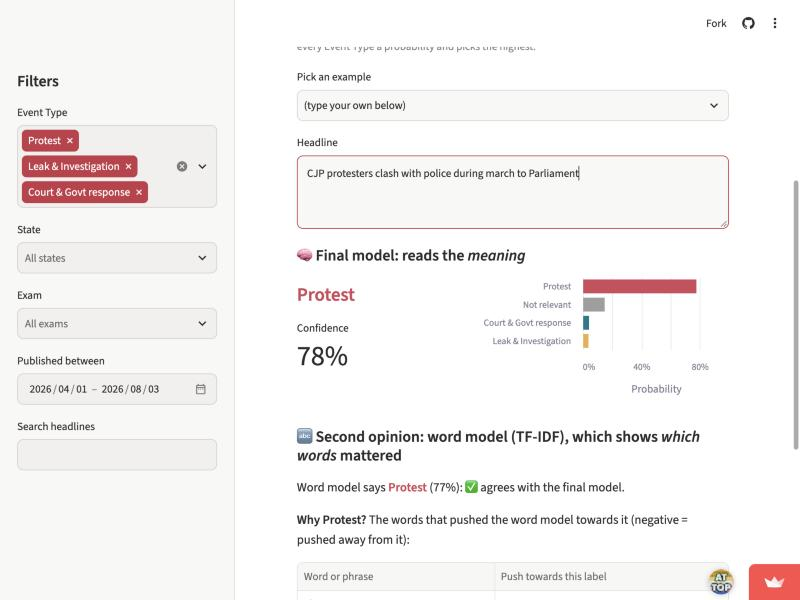
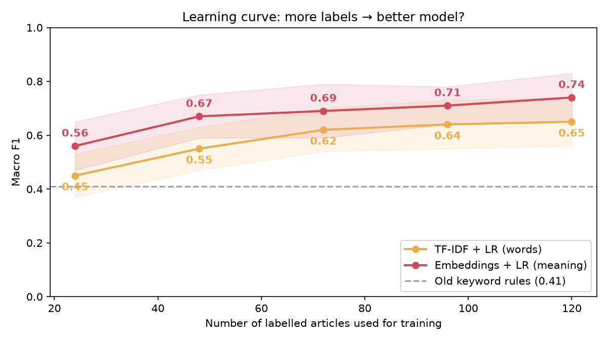
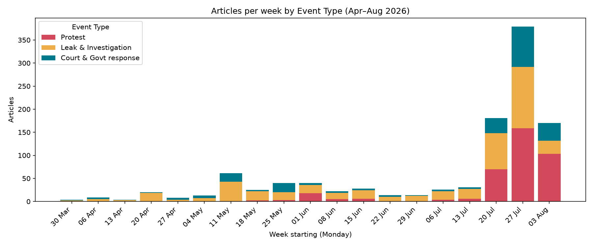
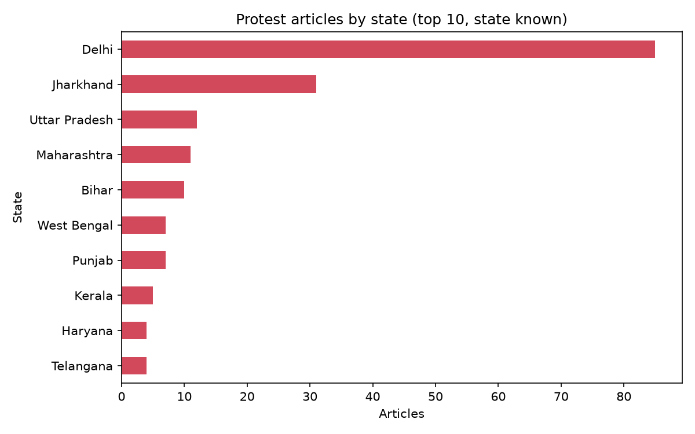
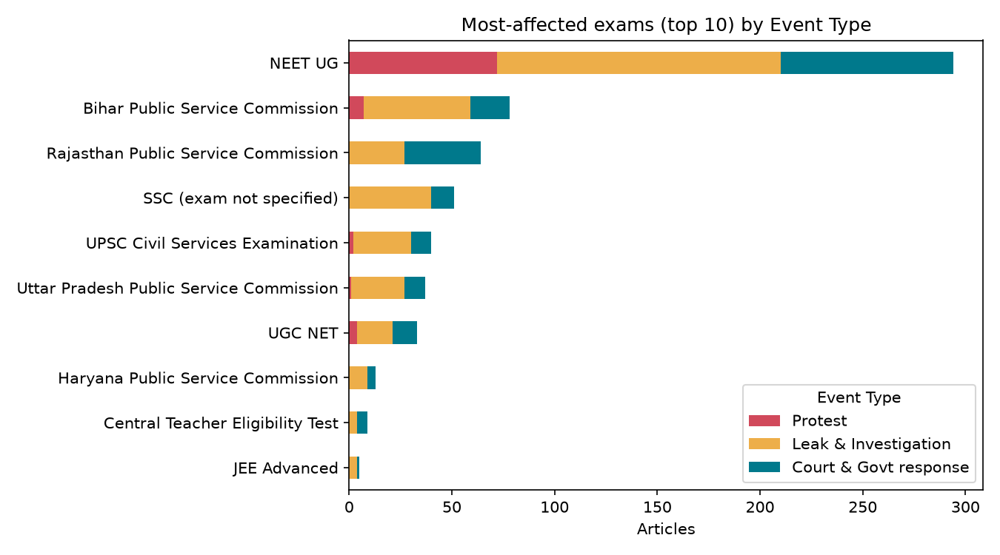
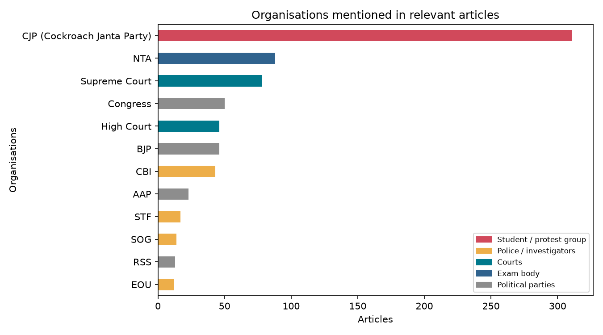
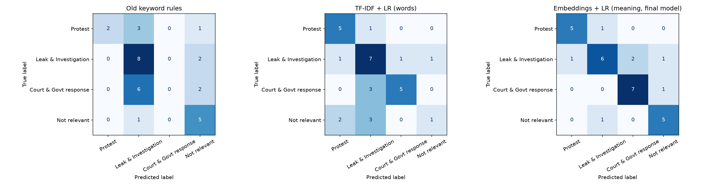

# 📰 CJP Protest Tracker

[](https://cjp-protest-tracker-s8z98dvbxk4aqrkghp6avr.streamlit.app/)


**Where, why and how did students protest exam paper leaks in India, and how did authorities respond?**

This project turns about 2,000 scattered news articles into a clean dataset. Each article is labelled by an ML model as a *Protest*, a *Leak & Investigation*, or a *Court & Govt response* story, and the results can be explored in an interactive dashboard.

**🔗 Live dashboard:** https://cjp-protest-tracker-s8z98dvbxk4aqrkghp6avr.streamlit.app/
*(It may take about 30 seconds to wake up if nobody has opened it recently.)*



---

## ⚡ Results at a glance

| | Before | After |
|---|---|---|
| Wrong exam labels (substring bug, e.g. "CAT" in "edu**cat**ion") | 297 | **2** |
| Duplicate stories | not detected | **78 removed** |
| Event Type accuracy, macro F1 (old keyword rules → final ML model) | 0.41 | **0.74** |

- **Learning beats rules:** every ML model beats the old keyword rules by at least 0.24 F1.
- **Meaning beats words:** sentence embeddings (+0.08) beat every word-counting model.
- **Main finding:** news coverage moved from *the leak* (64%) to *the protest* (48% of coverage from late July), centred on Delhi.

---

## Contents
1. [How it works](#1-how-it-works)
2. [Fixing data quality](#2-fixing-data-quality)
3. [ML: classifying Event Type](#3-ml-classifying-event-type)
4. [Findings](#4-findings)
5. [Limitations and future work](#5-limitations-and-future-work)
6. [Run it yourself](#6-run-it-yourself)

---

## 1. How it works

```
News (Google News RSS · GNews · NewsData.io, 27 keywords)
        │   original internship pipeline
        ▼
2,072 articles ─► clean ─► fixed rules ─► remove duplicate stories ─► 1,986 articles
        │
150 hand-labelled ─► sentence embeddings + Logistic Regression ─► Event Type for every article
        │
        ▼
charts + findings  ·  Streamlit dashboard
```

- **Stage 1 (internship):** a pipeline that collects paper-leak news from 3 sources into a Google Sheet.
- **Stage 2 (this repo):** measure the data quality, fix the extraction rules, train and evaluate ML models, analyse the results, and build a dashboard.

## 2. Fixing data quality

Measured on the same 2,072 articles:

| | Original output | New rules |
|---|---|---|
| Wrong CAT / NDA / MAT labels | 297 | **2** (both real mentions) |
| State = Unknown | 71% | **66%** |
| Exam = Unknown | 54% | 56%\* |
| Rows with HTML junk (`&nbsp;`) | 1,772 | **0** |
| Exam Year guessed from publish date | 1,733 | **0** |
| Duplicate stories removed | 0 | **78** |
| Rows with an organisation identified | not tracked | **38%** |

\* "Unknown exam" rose slightly *because the fake labels were removed*. The old 54% only looked better because about 295 articles had a wrong exam attached.

**The fixes:**
- Whole-word regex (`\b`) instead of substring matching.
- Longest names checked first ("NEET PG" before "NEET").
- Ambiguous short names (e.g. NDA, which is also the political alliance) only count when followed by *exam / paper / result / a year*.
- A city-to-state list (Patna → Bihar, Jantar Mantar → Delhi).
- `assert` checks in the notebook prove each bug is fixed.

## 3. ML: classifying Event Type

**4 labels:** `Protest` · `Leak & Investigation` · `Court & Govt response` · `Not relevant`

**Answer key:** 150 random articles. An AI assistant (Claude) suggested labels, and I checked every one.

**Two models**, both using Logistic Regression, differing in how a headline becomes numbers:
- **Word model, TF-IDF:** scores each word. It can explain *which words* drove a prediction.
- **Meaning model, sentence embeddings** (`all-MiniLM-L6-v2`): turns each headline into 384 numbers describing its *meaning*, so "arrested", "detained" and "held" land close together. **This is the final model.**

### Comparing 6 approaches
Each was tested on the same 25 cross-validation splits (5 folds × 5 shuffles):

| Approach | Macro F1 | ± spread | Accuracy |
|---|---|---|---|
| **Embeddings + Logistic Regression (final)** | **0.74** | 0.09 | **0.75** |
| Linear SVM (words) | 0.67 | 0.08 | 0.68 |
| TF-IDF + Logistic Regression (words) | 0.66 | 0.08 | 0.67 |
| Naive Bayes (words) | 0.65 | 0.09 | 0.68 |
| Old keyword rules | 0.41 | 0.07 | 0.51 |
| Always guess the most common label | 0.13 | 0.00 | 0.35 |

- **The three word models are tied**: their gaps (0.65–0.67) are smaller than their spread. Changing the *algorithm* didn't help.
- **Changing the *input* did:** reading meaning added +0.08.
- **On a single 30-article test set**, the scores were: rules 0.42 → word model 0.57 → **meaning model 0.77**. The old rules never got "Court & Govt response" right (F1 0.00), because "Paper Leak" was always checked first.


### Learning curve: would more labels help?

| Labelled articles used | 24 | 48 | 72 | 96 | 120 |
|---|---|---|---|---|---|
| Words (TF-IDF): test F1 | 0.45 | 0.55 | 0.62 | 0.64 | 0.65 |
| **Meaning (embeddings): test F1** | **0.56** | **0.67** | **0.69** | **0.71** | **0.74** |

- The **word model slows down**: its first 48 extra labels added +0.17, its last 48 only +0.03. It is also perfect on its own training data (1.00) but 0.65 on new data, which is strong overfitting.
- The **meaning model starts higher and is still rising at 120**, with a smaller train/test gap (0.93 vs 0.74). **More labels is the next step.**



### Error analysis: why the word model fails
Each labelled article was predicted by a model that hadn't seen it (5-fold `cross_val_predict`): **107 right, 43 wrong**.

| Pattern | Mistakes | Example |
|---|---|---|
| **"Paper leak" drowns out the real action** | 11 | *"7 govt teachers suspended over SSC paper leak"* → Leak (should be Court & Govt) |
| **"CJP" has two meanings** (also the Chief Justice of Pakistan) | 6 | *"CJP stresses swift resolution of tax disputes"* → Protest (should be Not relevant) |
| **Exam notices look like leak news** | 5 | *"HPBOSE Class 12 Question Paper with Answer Key"* → Leak (should be Not relevant) |
| **Rare protest words** (*bandh*) | 4 | *"NEET paper leak, Bihar bandh…"* → Leak (should be Protest) |

**Lesson:** the word model *counts words* but doesn't *understand the sentence*. That is what led to trying the meaning model.

The dashboard's **🤖 Try the model** tab shows both models side by side: the meaning model's prediction, plus the word model's "Why?" table.

## 4. Findings

1. **Coverage moved from the leak to the protest.** From April to mid-July 2026, 64% of relevant articles were about leaks and investigations and 13% about protests. From 27 July, protests became the largest share at 48%.
2. **Delhi was the centre of the protests**, with 85 protest articles (Jantar Mantar, the Parliament march). Jharkhand was second with 31 (JPSC/JSSC exams).
3. **NEET UG dominates** with 294 relevant articles and the most protest coverage (72). State exams (BPSC, UPPSC) appear mainly as leak stories.
4. **Authorities responded mostly through courts and laws.** The Supreme Court (78 articles) and High Courts (46) appear more than any investigating agency, and Parliament amended the anti-paper-leak law. In Rajasthan, court and government stories (37) outnumber leak stories (27).
5. **One group led the movement:** CJP appears in 311 articles, more than three times the exam body NTA (88), and more than any political party.

<details>
<summary>📊 Charts behind the findings</summary>







</details>

## 5. Limitations and future work

**Limitations**
- **Headlines only:** the original pipeline didn't save full article text.
- **Small answer key:** 150 labels, so the single test-set score is noisy. Cross-validation is the reliable number.
- **Collection bias:** Google News returns the newest results first, so early August 2026 is over-represented.
- **One label per field:** an article about two exams or states gets only the first match.
- **AI-suggested labels** may have influenced the answer key.

**Future work**
- **Label 300+ articles:** the meaning model is still improving at 120. Start with its least-confident predictions (*active learning*).
- **Save full article text** when fetching.
- **Fine-tune a small BERT model** once there are a few hundred labels.
- **spaCy NER** for places and organisations, to reduce "Unknown" states.
- **Daily automatic collection** with GitHub Actions.

## 6. Run it yourself

```bash
git clone https://github.com/realadityagupta/cjp-protest-tracker.git
cd cjp-protest-tracker
pip install -r requirements.txt
streamlit run app.py
```

The first prediction in the 🤖 tab downloads the embedding model (about 90 MB).

**Notebook:** open `CJP_v2.ipynb` in Jupyter or Google Colab and *Run all*. In Colab, upload `CJp_Dataset spreadsheet (1).xlsx` and `data/labels.csv` first.

### Project structure
```
├── app.py                         Streamlit dashboard
├── CJP_v2.ipynb                   Full analysis: cleaning → rules → ML → evaluation → charts
├── CJp_Dataset spreadsheet (1).xlsx   Input: 2,072 articles from the internship pipeline
├── requirements.txt               Dependencies (CPU-only PyTorch for deployment)
├── data/
│   ├── final_dataset.csv          Every article with its Event Type, state, exam, organisations
│   ├── labels.csv                 The 150-article answer key
│   ├── clean_articles.csv         Cleaned articles with the fixed rules
│   └── *.csv                      Evaluation results (comparison, learning curve, errors)
├── models/
│   ├── event_type_embeddings.joblib   Final model (meaning)
│   └── event_type.joblib              Word model (used for "Why?" explanations)
├── charts/                        Charts used in this README
└── docs/                          Dashboard screenshot
```

**Tech:** Python · pandas · regex · RapidFuzz · scikit-learn · Sentence Transformers · Matplotlib · Altair · Streamlit

<details>
<summary>🎤 Demo script (5 minutes)</summary>

1. **The problem (30 s):** paper leaks led to the 2026 CJP student protests, but the news is scattered.
2. **What I built first (30 s):** the internship pipeline, and why its data was unreliable (the CAT/education example).
3. **The fix (1 min):** the before/after table.
4. **The ML part (1.5 min):** the 4 labels and the 150-article answer key → error analysis of the word model ("it counts words") → the fix, a meaning model (0.74 vs 0.66 over 25 tests) → the learning curve ("still rising, so more labels next").
5. **The dashboard (1.5 min):** filter to *Protest*, show Delhi and Jharkhand, search "hunger strike". Then open **🤖 Try the model**, pick *"Government cancels recruitment exam…"* (the meaning model is right and the word model is wrong), and invite the teacher to type their own headline.
6. **Limitations and next steps (30 s).**

</details>
